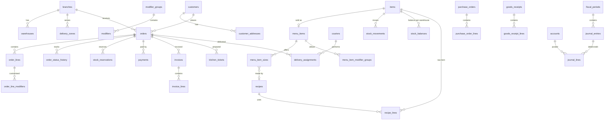

# DATABASE_SCHEMA — مخطط قاعدة البيانات

**الإصدار:** 0.1 · **التاريخ:** 2026-11-20 · **المرحلة:** 3
**المتطلبات:** DB-01..15، وACC-13/16/17/19، وINV-03/11، وPOS-13

**الملفات:**
| الملف | المحتوى |
|---|---|
| `apps/api/prisma/schema.prisma` | المخطط: 78 جدولاً، و12 تعداداً |
| `apps/api/prisma/migrations/0001_init` | الجداول والفهارس والمفاتيح، مولّدة من المخطط |
| `apps/api/prisma/migrations/0002_integrity` | قيود السلامة المالية والمخزنية (§4) |
| `tests/db/run_integrity_tests.py` | اختبار القيود على PostgreSQL 16 حقيقي (§5) |

> المخطط مكتوب بـ Prisma وفق ADR-01 المقترح (OI-35). إذا لم يُعتمد ADR-01 تبقى الجداول والقيود كما هي، ويتغير أسلوب الوصول فقط.

## 1. المحرك والأنواع (DB-01، DB-07)

| النوع | المواصفة |
|---|---|
| المحرك | PostgreSQL 16 |
| المعرّفات | UUID، والأرقام المقروءة للمستخدم في حقل `number` منفصل |
| المبالغ | `numeric(14,2)` بالريال |
| التكلفة والكميات | `numeric(14,4)` |
| النسب | `numeric(5,4)` |
| الأوقات | `timestamptz` بتوقيت UTC، وتُعرض بتوقيت الرياض |

لا أعداد عشرية تقريبية في أي حقل مالي.

## 2. الجداول حسب المجال (DB-02: 78 جدولاً، والحد الأدنى المطلوب 40)

| المجال | العدد | الجداول |
|---|---|---|
| الشركة والإعدادات (SET-01، PRJ-04) | 6 | `companies`، `branches`، `branch_hours`، `warehouses`، `tax_rates`، `document_sequences` |
| الهوية والصلاحيات (SEC-01..09) | 6 | `users`، `roles`، `permissions`، `role_permissions`، `user_roles`، `sessions` |
| الأصناف والوحدات (PRD، MNU-01) | 5 | `units`، `items`، `unit_conversions`، `item_barcodes`، `item_categories` |
| القائمة (MNU-02..06) | 8 | `menu_categories`، `menu_items`، `menu_item_sizes`، `modifier_groups`، `modifiers`، `menu_item_modifier_groups`، `allergens`، `menu_item_allergens` |
| الوصفات والإنتاج والهدر (RCP-01..05) | 4 | `recipes`، `recipe_lines`، `production_batches`، `waste_records` |
| الأسعار والعروض (PRC، ACC-24) | 5 | `price_lists`، `price_list_items`، `promotions`، `coupons`، `coupon_redemptions` |
| المخزون (INV) | 6 | `stock_lots`، `stock_balances`، `stock_movements`، `stock_reservations`، `stock_counts`، `stock_count_lines` |
| المشتريات (PUR) | 6 | `suppliers`، `purchase_orders`، `purchase_order_lines`، `goods_receipts`، `goods_receipt_lines`، `supplier_invoices` |
| العملاء والولاء (CRM-01، LOY-01) | 4 | `customers`، `customer_addresses`، `complaints`، `loyalty_transactions` |
| الطلبات (ORD، OPS-05) | 5 | `orders`، `order_lines`، `order_line_modifiers`، `order_status_history`، `order_ratings` |
| المطبخ (KIT) | 2 | `kitchen_stations`، `kitchen_tickets` |
| التوصيل (ORD-04..09، OPS-04، DRV) | 4 | `delivery_zones`، `couriers`، `delivery_providers`، `delivery_assignments` |
| نقاط البيع (POS) | 3 | `pos_terminals`، `pos_shifts`، `idempotency_keys` |
| المدفوعات والفواتير (POS-05، DB-15، CMP-02) | 4 | `payments`، `refunds`، `invoices`، `invoice_lines` |
| المحاسبة: نواة الأستاذ العام (ACC، OI-12) | 5 | `accounts`، `cost_centers`، `fiscal_periods`، `journal_entries`، `journal_lines` |
| البنية المشتركة | 5 | `outbox_events`، `audit_logs`، `notifications`، `integration_logs`، `attachments` |

## 3. العلاقات الرئيسية

**ربط المصدر بالقيد** (ACC-18): كل قيد يحمل `sourceType` و`sourceId` و`entryKind`، وعليها **مفتاح فريد**. لذلك لا يتكرر قيد المصدر الواحد (ACC-19). وبالطريقة نفسها تحمل كل حركة مخزنية مصدرها (INV-03).

## 4. قيود السلامة في قاعدة البيانات (0002_integrity)

| القيد | الآلية | المتطلب |
|---|---|---|
| القيد المرحّل متوازن: المدين = الدائن > 0، وسطران على الأقل | مشغّل قيد مؤجل يُفحص عند الإيداع | ACC-16، AC-05 |
| السطر مدين أو دائن، لا الاثنان، ولا قيمة سالبة | CHECK | ACC-16 |
| لا تعديل ولا حذف لقيد مرحّل أو لسطوره | مشغّلات BEFORE | ACC-17، DB-10 |
| لا قيد في فترة مقفلة | مشغّل BEFORE INSERT | ACC-13 |
| قيد واحد لكل (مصدر، نوع) | UNIQUE | ACC-19 |
| الحركات المخزنية، وسجل التدقيق، وسجل حالات الطلب، وسطور الفواتير: للإلحاق فقط | مشغّلات تمنع UPDATE وDELETE | INV-03، DB-08، ORD-02 |
| لا رصيد سالب، ولا حجز يتجاوز الرصيد | CHECK على `stock_balances` | INV-11، AC-01 |
| مفتاح عدم التكرار فريد للطلبات | UNIQUE | POS-13، AC-03 |
| الفاتورة الصادرة لا تُحذف ولا تُعدَّل، إلا حالة إرسالها إلى «فاتورة» | مشغّل | DB-10، CMP-02 |
| عدّاد «فاتورة» فريد لكل فرع | UNIQUE (`branchId`, `icv`) | DB-15 |
| 33 مفتاحاً خارجياً إضافياً، و14 قيد CHECK | ALTER TABLE | DB-03 |

### أسلوب الترحيل الإلزامي

1. يُنشأ القيد بحالة `DRAFT`.
2. تُضاف السطور.
3. تُحدَّث الحالة إلى `POSTED`.

**كل ذلك في معاملة واحدة.** فحص التوازن يعمل عند الإيداع. والتصحيح بعد الترحيل بقيد عكسي جديد يشير إلى الأصل عبر `reversesId`.

## 5. دليل الاختبار (TST-03)

شُغّل `tests/db/run_integrity_tests.py` في 2026-11-20 على PostgreSQL 16.15، بعد تطبيق 0001 و0002 على قاعدة فارغة. **النتيجة: 16/16 ناجح.** كل حالة رفض تتحقق من **سبب الرفض** الصحيح، لا من حدوث الرفض فقط.

| # | الحالة | النتيجة |
|---|---|---|
| 1 | قيد متوازن يُرحَّل | ✓ |
| 2 | قيد غير متوازن يُرفض عند الترحيل | ✓ |
| 3 | سطر بمدين ودائن معاً يُرفض | ✓ |
| 4–7 | تعديل قيد مرحّل، أو حذفه، أو تعديل سطوره، أو إضافة سطر إليه: كلها تُرفض | ✓ |
| 8 | قيد في فترة مقفلة يُرفض | ✓ |
| 9 | قيد مكرر لنفس المصدر يُرفض | ✓ |
| 10 | تعديل حركة مخزنية يُرفض | ✓ |
| 11–12 | حجز يتجاوز الرصيد، أو رصيد سالب: يُرفضان | ✓ |
| 13 | طلب بمفتاح عدم تكرار مكرر يُرفض | ✓ |
| 14–16 | تعديل مبلغ فاتورة يُرفض، وتحديث حالة «فاتورة» مسموح، وحذف الفاتورة يُرفض | ✓ |

**ملاحظة:** في التشغيل الأول اكتشف الاختبار خطأً في دالة التوازن، فقد كانت تقرأ حقلاً غير موجود عند التشغيل على جدول القيود. صُحّح الخطأ، وأصبحت الاختبارات تتحقق من سبب الرفض لمنع أي نجاح زائف.

## 6. ما يُستكمل

| البند | السبب |
|---|---|
| أسماء الأدوار الأحد عشر وبذور الصلاحيات (SEC-01) | القائمة في الأمر التنفيذي (OI-27). البنية جاهزة |
| دليل الحسابات الفعلي | يُعد مع المحاسب، وتلزمه الأرصدة الافتتاحية (OI-18) |
| طريقة تقييم المخزون (OI-08) وسياسة التقريب (OI-23) | تؤثران على منطق الخدمة لا على الجداول |
| النسخ الاحتياطي واختبار الاستعادة (DB-11، DB-12) | مع الاستضافة (OI-07) |
| رسم ERD تفصيلي لكل مجال | مع بناء كل وحدة |
